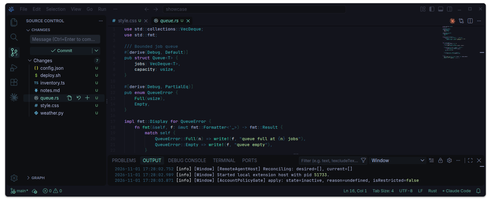
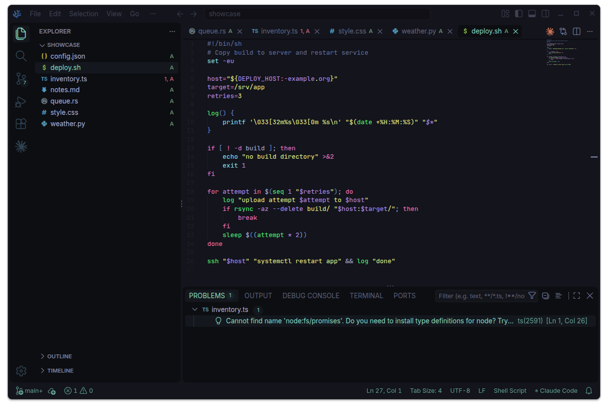

# Lichen Theme for VS Code

<p align="center">Lichen greens on dark. Less chaos.</p>





## Usage

Install "Lichen" directly in Extensions.

> [!TIP]
> Extension only sets colours. For the look in screenshots, also copy [layout.json](.vscode/layout.json) into your settings.

### Manual copy

Paste [settings.json](.vscode/settings.json) into `Preferences: Open User Settings (JSON)` (`Ctrl+Shift+P`).

Or pick what you like only:

| File                                   |                                                    |
| -------------------------------------- | -------------------------------------------------- |
| [settings.json](.vscode/settings.json) | Full theme                                         |
| [colors.json](.vscode/colors.json)     | Colours only                                       |
| [layout.json](.vscode/layout.json)     | Tab style, tree indent, breadcrumbs and other bits |

<br>

> [!NOTE]
> Manual copy includes - make sure this is what you want:
>
> ```json
> "editor.fontFamily": "'JetBrains Mono', 'Google Sans Code', monospace",
> "editor.fontSize": 12.5,
> "editor.formatOnSave": true,
> "window.zoomLevel": 0.2
> ```

<br>

## License

- [MIT](LICENSE)
